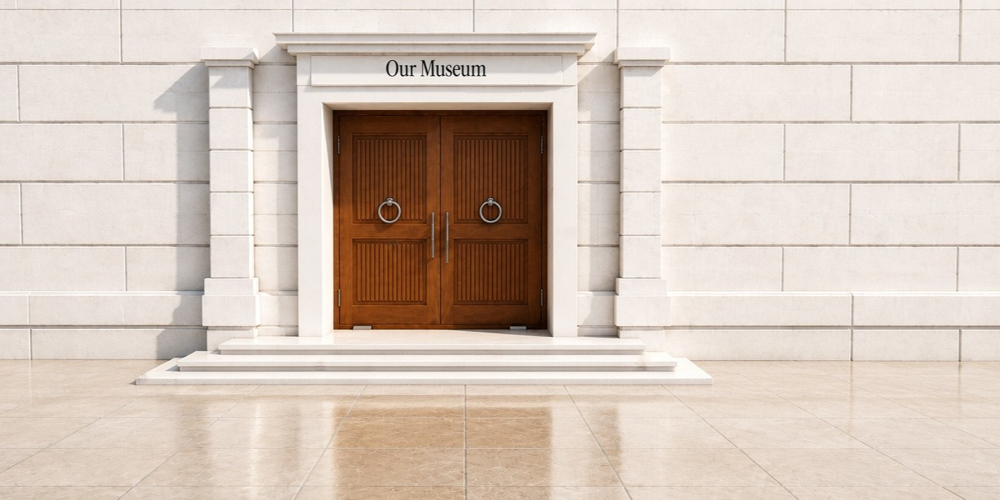
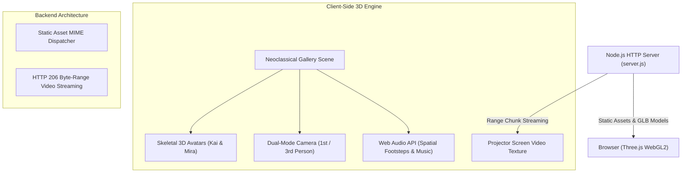

# 🏛️ 3D Virtual Museum — Interactive 3D Art Gallery

<p align="center">
  
</p>

<p align="center">
  <strong>An immersive, self-hosted 3D neoclassical art exhibition experience built with Three.js and native Node.js.</strong>
</p>

<p align="center">
  <a href="#-features"></a>
  <a href="#-tech-stack"></a>
  <a href="#-zero-dependencies"></a>
  <a href="#-offline-first"></a>
  <a href="#-license"></a>
</p>

---

## 📖 Overview

**3D Virtual Museum** is an interactive, web-based virtual art exhibition platform designed to bring classical museum spaces into the modern browser.

Set within an expansive neoclassical gallery featuring marble halls, vaulted ceilings, classical Corinthian columns, and ambient skylight illumination, the experience allows visitors to freely explore curated art collections using fully animated 3D avatars.

Built entirely on **Three.js** and **native Node.js**, the project operates with **zero external dependencies** and works completely offline without requiring third-party cloud services or complex build pipelines.

---

## ✨ Features

| Feature | Description |
| :--- | :--- |
| 🏛️ **Neoclassical Exhibition Hall** | Architectural 3D gallery featuring realistic PBR materials, baked ambient occlusion lightmaps, marble specular reflections, and directional artwork spotlights. |
| 🧍 **Customizable 3D Avatars** | Choose between **Kai** and **Mira**. Customize skin tones, hair colors, heights, waistcoats, trousers, and shoes via an interactive entrance lobby. |
| 🎨 **Interactive Art Viewing** | 12 high-resolution framed paintings equipped with proximity detection. Press <kbd>E</kbd> near any painting to enter close-up inspection mode with curator placards. |
| 🎬 **In-Gallery Video Projection** | A central cinema projection screen continuously playing exhibition film reels with native HTTP 206 byte-range streaming for smooth playback and seeking. |
| 🎵 **Spatial Soundscape** | Background orchestral soundtrack, hall reverberation, and spatial footstep audio synchronized with movement velocity (walk, sprint, jump). |
| 🎥 **Dual Camera Modes** | Seamlessly toggle between **Third-Person** over-the-shoulder follow-camera and **First-Person** eye-level perspective (<kbd>V</kbd> key or Eye icon). |
| ⚡ **Zero-Dependency Server** | Powered by a lightweight Node.js HTTP server built exclusively with native standard libraries (`http`, `fs`, `path`). |
| 📱 **Responsive HUD & Settings** | Full onscreen HUD for volume adjustments, audio mute, graphics quality selection, and fullscreen display. |

---

## 🎮 Controls & Navigation

| Control | Action |
| :--- | :--- |
| <kbd>W</kbd> <kbd>A</kbd> <kbd>S</kbd> <kbd>D</kbd> or Arrow Keys | Walk / Move through the gallery |
| <kbd>Shift</kbd> (Hold) | Sprint / Run faster |
| <kbd>Space</kbd> | Jump |
| **Mouse / Trackpad (Click & Drag)** | Look around (360° panoramic rotation) |
| <kbd>V</kbd> or 👁️ Icon | Toggle between **First-Person** and **Third-Person** camera |
| <kbd>E</kbd> | Inspect artwork closer (when standing near paintings) |
| <kbd>F</kbd> | Sit down on gallery benches |
| **Top-Right HUD** | Adjust Master Volume, SFX, Graphics Quality, and Fullscreen mode |

---

## 🚀 Getting Started

### Prerequisites
- [Node.js](https://nodejs.org/) (version 18.0.0 or higher).
- A modern web browser with WebGL2 support (Chrome, Firefox, Safari, Edge, Brave).

### Installation & Run

1. **Clone the repository:**
   ```bash
   git clone https://github.com/devXsentinel/3d-virtual-museum.git
   cd 3d-virtual-museum
   ```

2. **Start the local server:**
   ```bash
   npm start
   # or directly:
   node server.js
   ```

3. **Visit the museum:**
   Open your browser and navigate to:
   ```
   http://localhost:8080/
   ```

> [!TIP]
> To run the server on a different port, set the `PORT` environment variable:
> ```bash
> PORT=3000 node server.js
> ```

---

## 🏗️ Technical Architecture



### 1. 3D Graphics & Rendering Pipeline
- **Engine**: Three.js r160 utilizing the WebGL2 rendering context.
- **Lighting Model**: Physically-Based Rendering (PBR) with high-dynamic-range tone mapping, soft shadow cascades, and real-time point spotlights focusing on each framed painting.
- **Materials**: Multi-layer PBR materials combining albedo, roughness, metalness, and normal maps for realistic marble flooring and brass frame fixtures.

### 2. Character Rigging & Animation
- Fully rigged 3D humanoid avatars with bone hierarchies for head, torso, limbs, and facial features.
- Skeletal Animation Mixer capable of smooth cross-fading between states (`idle`, `walk`, `sprint`, `jump`, `sit`).
- Dynamic runtime material tinting for customizable skin tones, hair colors, and apparel.

### 3. Audio & Video Subsystems
- **Web Audio API**: Real-time positional sound spatialization for footsteps and environmental sound effects.
- **Range-Request Video Streaming**: Built-in HTTP 206 Partial Content server support enabling instantaneous seeking and buffering for the gallery projection screen.

---

## 📂 Project Structure

```text
3d-virtual-museum/
├── package.json               # Project manifest and npm start script
├── server.js                  # Zero-dependency Node.js HTTP server (with HTTP 206 range streaming)
├── README.md                  # Project documentation
├── .gitignore                 # Git ignore rules
└── site/                      # Web application root
    ├── index.html             # Main entry page, UI HUD, and avatar customizer
    ├── app.js                 # Three.js 3D museum engine and game loop
    ├── assets/                # Core 3D assets, audio, and textures
    │   ├── animations/        # Skeletal character animation clips (.glb)
    │   ├── characters/        # 3D visitor models (kai.glb, mira.glb)
    │   ├── emotes/            # Expressive gesture animations (.glb)
    │   ├── lobby/             # Entrance lobby textures
    │   ├── music/             # Orchestral background soundtrack (.mp3)
    │   ├── photos/            # Gallery frame textures
    │   ├── skin/              # Avatar skin, outfit, and facial texture maps
    │   └── video/             # Gallery projection film reel (.mp4)
    ├── c/                     # Stylesheets, vendor scripts, and WOFF2 typography
    ├── gallery/               # Exhibition paintings and video media
    └── gift-data/             # Curated museum exhibition metadata & descriptions
```

---

## 🎨 Personalizing Your Exhibition

You can easily adapt the museum to showcase your own portfolio, artwork, or photography:

### 1. Replacing Exhibition Paintings
- Browse to [`site/gallery/`](site/gallery).
- The exhibition hall contains 12 framed painting positions, stored in standard image resolutions (`main`, `768`, and `384` `.webp` files).
- Replace any existing image file with your own photo or artwork while maintaining the filename.

### 2. Updating the Projection Video
- Replace [`site/gallery/c230ef95d01a39d3b2cc4aa75f479d1f-main.mp4`](site/gallery/c230ef95d01a39d3b2cc4aa75f479d1f-main.mp4) with your own `.mp4` video.
- The built-in streaming server automatically supports smooth video seeking and playback on the in-game screen.

### 3. Changing Background Music
- Replace [`site/assets/music/st.mp3`](site/assets/music/st.mp3) with any `.mp3` audio track to customize the auditory atmosphere.

---

## 🛠️ Tech Stack

* **3D Graphics Engine**: [Three.js r160](https://threejs.org/)
* **Runtime / Server**: [Node.js](https://nodejs.org/) (Native Standard Library)
* **Audio**: HTML5 Web Audio API
* **Typography**: Instrument Serif & Inter (WOFF2)
* **Formats Supported**: GLTF / GLB, WebP, MP3, MP4, WOFF2

---

## 📄 License

This project is open-source and available under the [MIT License](LICENSE).
